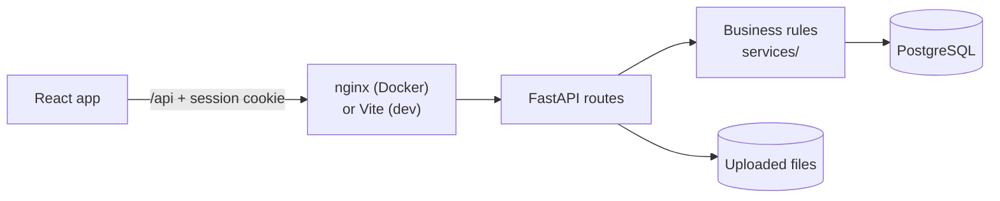

<div align="center">


# ReturnDesk

**Product returns and warranty management for a small online store**

[](https://github.com/saxipatel-dev/returndesk/actions/workflows/ci.yml)


[Features](#features) · [Screenshots](#screenshots) · [Tech stack](#tech-stack) · [Architecture](#architecture-and-database) · [API](#api) · [Run it locally](#run-it-locally) · [Tests](#tests) · [Docs](#documentation)

</div>

---

ReturnDesk handles what happens after a customer wants to send something back. Customers submit
**return** or **warranty** requests against their orders, support staff review them in a shared
work queue, and administrators manage the catalog, staff accounts and return policy, with an
analytics dashboard that shows how it's all going.

I built it as a self-directed portfolio project to practice a realistic business workflow end to
end: relational data modeling, role-based access control, a status workflow with an audit trail,
file uploads, and reporting. All customers, orders and products are fictional demo data.


## Features

### Customer portal
- Register, sign in, and see every order with **what can still be returned and until when**
- Submit a **return** (inside the store's return window) or a **warranty claim** (inside the product's warranty period)
- Attach photos or receipts: JPG, PNG, WEBP or PDF up to 5 MB, checked on the server
- Track each request with a progress bar and a full timeline, message support, cancel before a decision
- In-app notifications whenever a request changes

### Employee portal
- Dashboard with the employee's own open work, requests waiting for pickup, and team workload
- Work queue with search (reference, order, product, customer), filters for status, type, dates and assignee, sorting and paging
- Assign requests to yourself or release them, **approve or reject** (a rejection always needs a reason), record a simulated refund, replacement or repair
- **Internal notes** that customers never see

### Administrator portal
- **Analytics dashboard**: 4 KPI cards and 7 charts calculated live in PostgreSQL, filterable by date range, status and request type, with CSV export
- Product catalog: add, edit, archive
- Staff accounts: create employees or admins, deactivate (signs them out immediately)
- Return policy: return window, customer cancellations, attachment limit
- Request monitor: everything an employee can do, plus assigning work to anyone

### Enforced by the API, not just the UI
- Customers can only ever see their own purchases, requests, comments and files (other people's come back as 404)
- A request can't ask for more units than are still returnable
- Only valid status changes are accepted, and each one is written to an audit log in the same transaction
- Decisions and fulfillment can't happen twice, even when two people click at the same moment (row-level locking, covered by a test)

<details>
<summary><strong>The seven charts and how each is calculated</strong></summary>

| Chart | Type | Metric |
|---|---|---|
| Monthly return requests | Line | Requests grouped by month created |
| Returns by product category | Bar | Requests grouped by the purchased product's category |
| Request status distribution | Donut | Requests grouped by current status |
| Most common return reasons | Horizontal bar | Requests grouped by selected reason |
| Average resolution time | Line | Mean days from creation to closure, closed requests only, by month closed |
| Employee workload | Bar | Open requests assigned to each active staff member |
| Approval vs. rejection trends | Grouped bar | Decisions grouped by month decided |

KPIs: total requests, pending review, approval rate (approved ÷ decided; shows **N/A**, not 0%, when
nothing has been decided), and average resolution days.
</details>

## Screenshots

| Customer dashboard | Submitting a return |
|---|---|
|  |  |
| **Request timeline and conversation** | **Employee work queue** |
|  |  |
| **Reviewing a request** | **Rejections require a reason** |
|  |  |
| **Product management** | **Works on phones** |
|  |  |

All 14 screenshots are in [`docs/screenshots`](docs/screenshots). They're generated from the demo
data by a Playwright script, so they always match the current UI.

## Tech stack

| Layer | Tools | Why |
|---|---|---|
| Frontend | React 19, Vite, React Router 7, Tailwind CSS 4, Axios, Lucide icons | Fast dev server, simple component model, utility CSS for a consistent design |
| Charts | Recharts 3 | Declarative React charts that are responsive out of the box |
| Backend | Python 3.12, FastAPI, Pydantic 2, Uvicorn | Typed request validation and automatic OpenAPI docs |
| Database | PostgreSQL 16, SQLAlchemy 2, Alembic | Relational data with constraints, row locks for safe concurrent updates, versioned migrations |
| Auth | Server-side sessions, `HttpOnly` cookie, CSRF token, Argon2 password hashing | Sessions can be revoked instantly; tokens aren't readable by scripts |
| Testing | Pytest, Vitest + React Testing Library, Playwright | API rules, UI components and full browser journeys |
| Tooling | Docker Compose, nginx, GitHub Actions, Ruff, ESLint, Prettier | One-command local stack and checks on every push |

## Architecture and database



The browser only ever talks to one origin: nginx (or Vite in development) serves the React app and
forwards `/api` to FastAPI. Route handlers stay thin; the rules for eligibility, permissions and
status changes live in `backend/app/services`. Requests move through
`pending_review → under_review → approved → fulfilled → closed`, or end as `rejected` or `cancelled`.

The PostgreSQL schema has 11 tables (users, products, purchases, purchase items, return requests,
events, comments, attachments, notifications, sessions and store settings), managed with Alembic
migrations. Money is stored as `NUMERIC`, timestamps are timezone-aware, and every status change is
recorded in an append-only `return_events` table.

- [Architecture details](docs/architecture/README.md): components, request lifecycle, sign-in flow
- [Database design](docs/database/README.md): ER diagram and schema notes
- [Design decisions](docs/project/DECISIONS.md): why sessions instead of JWT, SQL analytics, row locks

## API

FastAPI generates interactive documentation: with the app running, open
**http://localhost:8000/api/docs** (or http://localhost:8080/api/docs with Docker). All endpoints sit
under `/api`, return JSON, and check permissions on the server. The
[API reference](docs/api/README.md) lists every endpoint with its access rules, error codes, metric
definitions and `curl` examples, and the OpenAPI schema is in
[docs/api/openapi.json](docs/api/openapi.json).

## Run it locally

You can run ReturnDesk with **Docker** (easiest: nothing else to install) or **directly on your
machine** (better for development, with hot reload).

### Option A: Docker

**Prerequisite:** [Docker Desktop](https://www.docker.com/products/docker-desktop/), running.

```bash
git clone https://github.com/saxipatel-dev/returndesk.git
cd returndesk
cp .env.example .env
docker compose up --build
```

The first build takes a few minutes. When the log shows `Uvicorn running`, open
**http://localhost:8080** and sign in with a [demo account](#demo-accounts).

| What | Where |
|---|---|
| App | http://localhost:8080 |
| API docs (Swagger) | http://localhost:8080/api/docs |
| Health check | http://localhost:8080/health |
| PostgreSQL (from your machine) | `localhost:5433`, user/db `returndesk`, password from `.env` |

Stop with `Ctrl+C` or `docker compose down`. Data is kept in a Docker volume; to start completely
fresh run `docker compose down -v`.

### Option B: run on your machine

**Prerequisites:** Python 3.12+, Node.js 22+, PostgreSQL 14+. On macOS with Homebrew:

```bash
brew install python@3.12 node postgresql@16
brew link --force postgresql@16        # versioned Postgres isn't added to PATH by default
brew services start postgresql@16
```

**1. Create the database user and databases** (one time)

```bash
psql postgres -c "CREATE ROLE returndesk LOGIN PASSWORD 'returndesk' CREATEDB;"
createdb -O returndesk returndesk        # the app
createdb -O returndesk returndesk_test   # backend tests
createdb -O returndesk returndesk_e2e    # Playwright tests
```

**2. Start the backend** (terminal 1, runs on http://localhost:8000)

```bash
cd backend
python3.12 -m venv .venv
.venv/bin/pip install -r requirements-dev.txt
.venv/bin/alembic upgrade head      # create tables
.venv/bin/python -m app.seed        # load demo data (use --reset to start over)
.venv/bin/uvicorn app.main:app --reload
```

**3. Start the frontend** (terminal 2, runs on http://localhost:5173)

```bash
cd frontend
npm install
npm run dev
```

Open **http://localhost:5173**. Vite forwards `/api` requests to the backend, so there's nothing
else to configure. The defaults match the database created in step 1; to use different
credentials, put a `DATABASE_URL` in `backend/.env` (every setting is explained in
[`.env.example`](.env.example)).

### Demo accounts

Created by the seed script for local use. **Password for all of them: `Demo#2026`**.

| Role | Email | Try this |
|---|---|---|
| Customer | `customer@example.com` | Start a return from **My purchases** |
| Employee | `priya@example.com` | Pick up a request in **Work queue** and approve it |
| Administrator | `admin@example.com` | Explore **Analytics** and change the date filter |

The login page has buttons that fill these in. A guided five-minute walkthrough is in
[docs/demo-script.md](docs/demo-script.md).

### Troubleshooting

| Problem | Fix |
|---|---|
| `port is already allocated` (Docker) | Change `WEB_PORT` or `DB_PORT` in `.env` |
| `connection refused` to PostgreSQL | Make sure Postgres is running (`brew services list`) |
| `role "returndesk" does not exist` | Run step 1 of Option B |
| Login works but pages show "We couldn't load this" | The backend isn't running on port 8000 |
| Want a clean slate | `backend/.venv/bin/python -m app.seed --reset` (or `docker compose down -v`) |

## Tests

| Suite | Count | Command |
|---|---|---|
| Backend: auth, permissions, return rules, workflow, analytics, uploads | 85 | `cd backend && .venv/bin/pytest` |
| Frontend: components, forms, utilities | 36 | `cd frontend && npm test` |
| End-to-end: real browser, API and database | 11 | `cd frontend && npx playwright install chromium && npx playwright test --project=e2e` |

Linting: `ruff check .` (backend) and `npm run lint` (frontend). GitHub Actions runs all of it,
plus a migration up/down check and the Docker builds, on every push. The latest results are in
[testing report](docs/project/TESTING_REPORT.md).

## Project structure

```
returndesk/
├── backend/
│   ├── app/
│   │   ├── api/          # routes: auth, catalog, returns, admin
│   │   ├── core/         # settings, database, password hashing, auth dependencies
│   │   ├── models/       # SQLAlchemy tables and enums
│   │   ├── schemas/      # Pydantic request/response models
│   │   ├── services/     # business rules: workflow, analytics, uploads, notifications
│   │   └── seed.py       # demo data
│   ├── alembic/          # migrations
│   └── tests/
├── frontend/
│   ├── src/
│   │   ├── api/          # Axios client and endpoint functions
│   │   ├── components/   # UI kit, layout, request views, charts
│   │   ├── pages/        # auth, customer, staff, admin, shared
│   │   └── ...           # context, hooks, utils
│   └── tests/            # unit/ (Vitest) and e2e/ (Playwright)
├── docs/                 # architecture, database, API, testing, project records, screenshots
├── docker-compose.yml
└── render.yaml           # deployment blueprint, kept for later (not deployed)
```

## Documentation

| Document | What's in it |
|---|---|
| [Architecture](docs/architecture/README.md) | Components, request lifecycle and auth diagrams |
| [Database](docs/database/README.md) | ER diagram and schema notes |
| [API reference](docs/api/README.md) | Every endpoint, error codes, metric definitions, curl examples |
| [Requirements](docs/requirements/README.md) | Scope, roles, screens, business rules and the tests that cover them |
| [Testing guide](docs/testing/README.md) | How the test suites are set up and run |
| [Deployment](docs/DEPLOYMENT.md) | Ready-to-use cloud setup for later (nothing is deployed) |
| [Project records](docs/project/) | [Testing report](docs/project/TESTING_REPORT.md), [progress log](docs/project/PROJECT_PROGRESS.md), [decisions](docs/project/DECISIONS.md), [known issues](docs/project/KNOWN_ISSUES.md) |

## Status and limitations

ReturnDesk is feature-complete for this version and runs locally. It is **not deployed** to a
public server; the deployment configuration is ready for when it is. Simplified on purpose:

- Notifications are in-app only (no email), and there's no password reset yet
- Refunds, replacements and repairs are simulated; no payment or shipping integration
- Uploaded files are stored on local disk
- No login rate limiting yet

Details are in [docs/project/KNOWN_ISSUES.md](docs/project/KNOWN_ISSUES.md).
