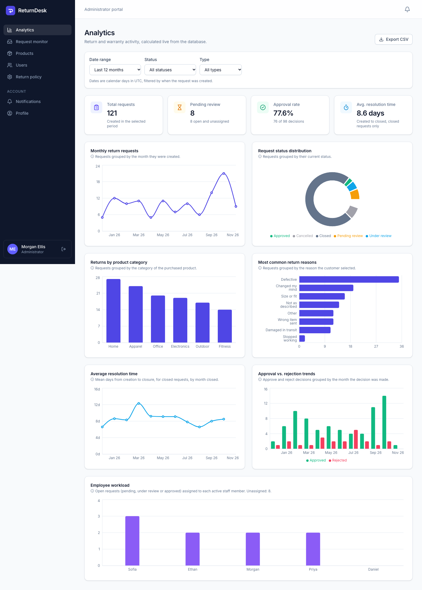
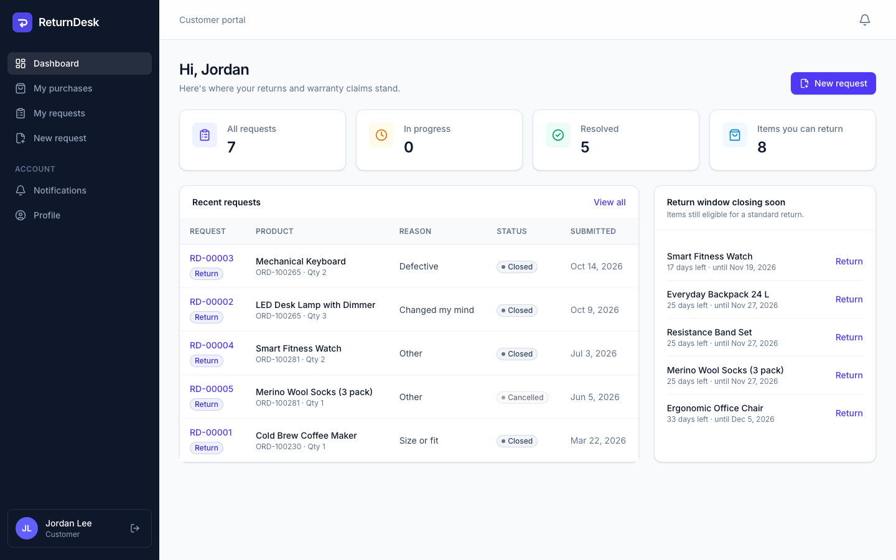
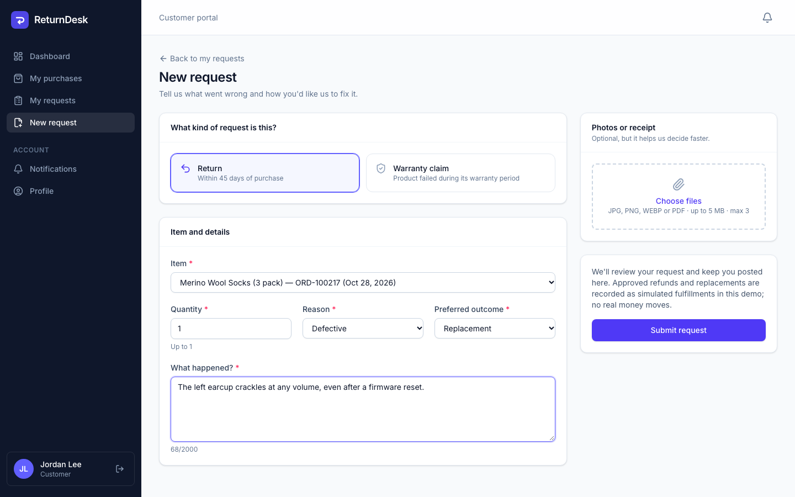
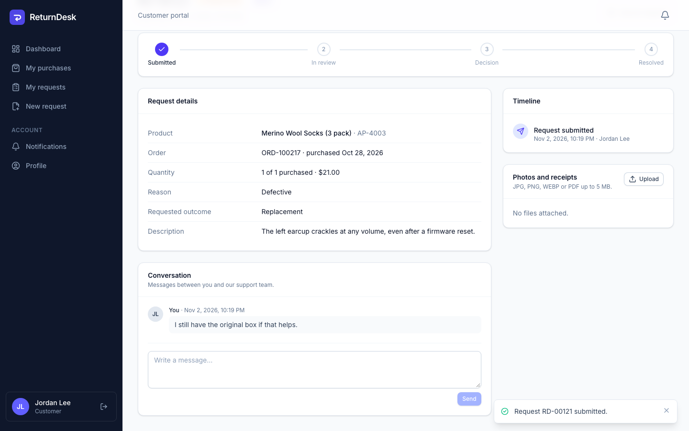
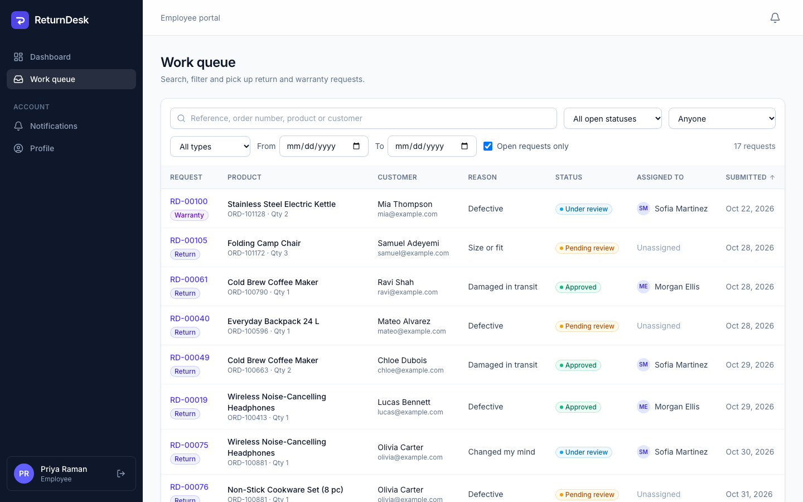
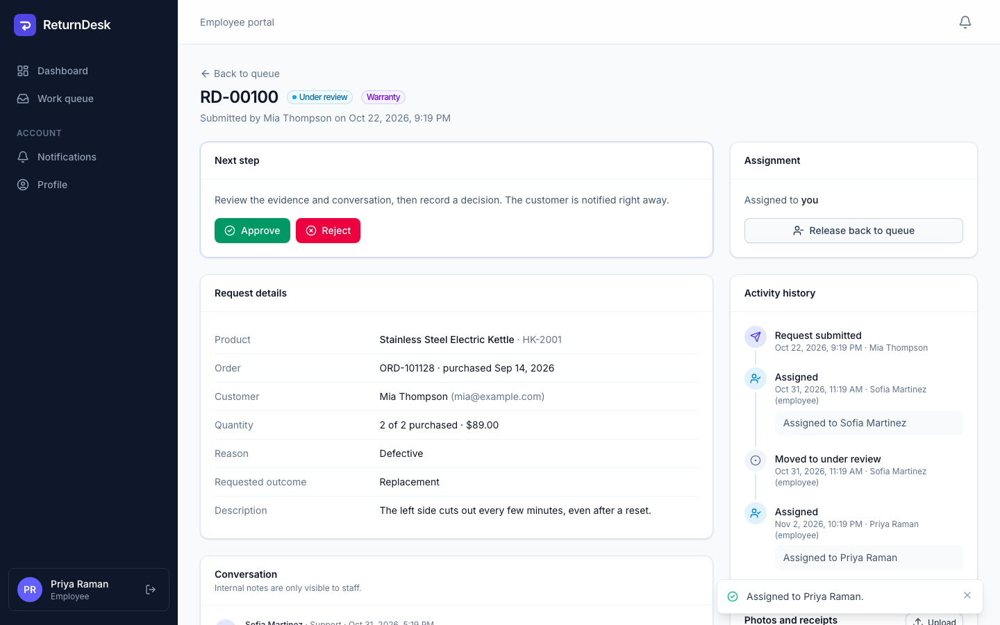
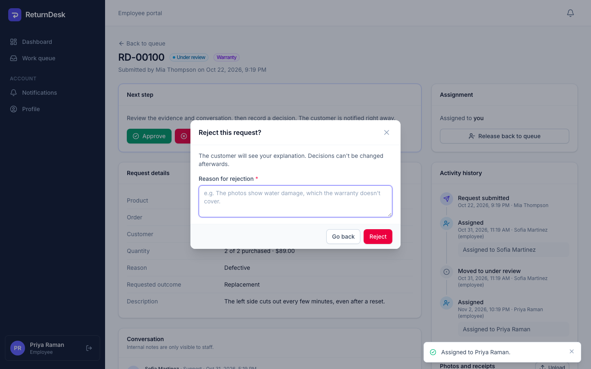
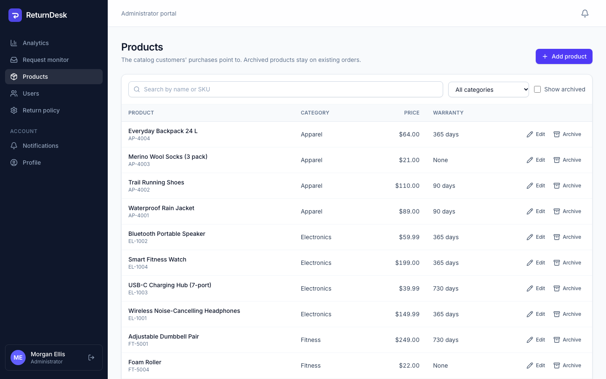
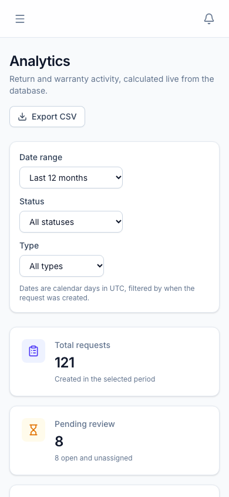
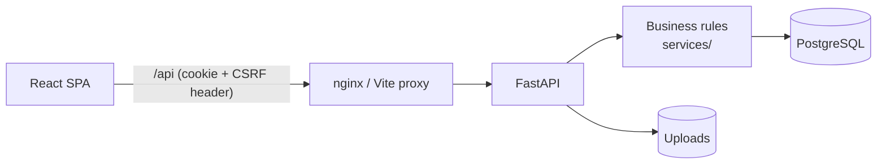

# ReturnDesk

**Product returns and warranty management for a small online store.** Customers submit return
or warranty requests against their orders, support staff review them in a shared queue, and
administrators manage the catalog, staff and return policy and see how things are going on an
analytics dashboard.

I built this as a self-directed portfolio project to practice a realistic business workflow
end to end: relational data modeling, role-based access, a state machine with an audit trail,
and reporting. All customers, orders and products are fictional demo data.



**Stack:** React 19 · Vite · Tailwind CSS · Recharts · FastAPI · SQLAlchemy 2 · Pydantic 2 ·
Alembic · PostgreSQL · Pytest · Vitest + React Testing Library · Playwright · Docker Compose ·
GitHub Actions

---

## Contents

- [What it does](#what-it-does)
- [Screenshots](#screenshots)
- [Architecture](#architecture)
- [Running it locally](#running-it-locally)
- [Demo accounts](#demo-accounts)
- [Tests](#tests)
- [Project structure](#project-structure)
- [Design decisions](#design-decisions)
- [Limitations and future work](#limitations-and-future-work)

## What it does

**Customers**
- Register and sign in; see their orders with what's still returnable and until when
- Submit a **return** (within the store's return window) or a **warranty claim** (within the product's warranty period)
- Attach photos or receipts (JPG/PNG/WEBP/PDF, checked server-side)
- Follow each request on a progress bar and timeline, message support, cancel before a decision
- Get in-app notifications whenever something changes

**Employees**
- A work queue with search (reference, order, product, customer), status/type/date/assignee filters and sorting
- Assign requests to themselves, approve or reject with an explanation, record a (simulated) refund, replacement or repair
- Internal notes that customers never see, and a dashboard with their own open work and team workload

**Administrators**
- Analytics dashboard: 4 KPIs and 7 charts calculated live in PostgreSQL, filterable by date range, status and type, with CSV export
- Product catalog management (add, edit, archive)
- Staff accounts (create, change role, deactivate, which signs them out immediately)
- Return policy settings (return window, cancellations, attachment limit)
- Everything an employee can do, plus assigning requests to anyone

**Rules the API enforces** (not just the UI): customers only ever see their own data, quantities
can't exceed what's still returnable, invalid status changes are rejected, a rejection needs a
reason, and decisions/fulfillment can't happen twice, even if two people click at the same moment.

## Screenshots

| | |
|---|---|
|  Customer dashboard |  Submitting a return |
|  Request timeline and conversation |  Employee work queue |
|  Reviewing a request |  Rejection requires a reason |
|  Product management |  Responsive layout |

The full set is in [`docs/screenshots`](docs/screenshots). They're generated from the seeded demo
data by a Playwright script (`npx playwright test --project=screenshots`).

## Architecture



A single FastAPI service and a React single-page app, served from one origin. Sessions are
server-side rows referenced by an `HttpOnly` cookie, with a per-session CSRF token. More detail,
including the request lifecycle and auth sequence diagrams, is in
[docs/architecture](docs/architecture/README.md). The ER diagram and schema notes are in
[docs/database](docs/database/README.md), and every endpoint is listed in [docs/api](docs/api/README.md).

Request lifecycle:
`pending_review → under_review → approved → fulfilled → closed`, or `under_review → rejected → closed`,
or `cancelled` before a decision.

## Running it locally

### Option 1: Docker (one command)

Needs Docker Desktop.

```bash
git clone https://github.com/saxipatel-dev/returndesk.git
cd returndesk
cp .env.example .env
docker compose up --build
```

Open **http://localhost:8080**. The API container runs migrations and loads demo data on first
start. API docs are at http://localhost:8080/api/docs.

### Option 2: run the pieces yourself

Needs Python 3.12+, Node 22+ and PostgreSQL 14+.

```bash
# Database
createuser returndesk --pwprompt         # use "returndesk" to match the defaults
createdb -O returndesk returndesk
createdb -O returndesk returndesk_test   # only needed for the backend tests

# Backend (http://localhost:8000)
cd backend
python3 -m venv .venv
.venv/bin/pip install -r requirements-dev.txt
.venv/bin/alembic upgrade head
.venv/bin/python -m app.seed             # demo data (add --reset to start over)
.venv/bin/uvicorn app.main:app --reload

# Frontend (http://localhost:5173), in a second terminal
cd frontend
npm install
npm run dev
```

The backend reads its settings from environment variables or `backend/.env`; every variable is
explained in [`.env.example`](.env.example). The defaults work for the setup above.

## Demo accounts

Created by the seed script, for local and demo use only. The password for all of them is `Demo#2026`.

| Role | Email |
|---|---|
| Customer | `customer@example.com` |
| Employee | `priya@example.com` |
| Administrator | `admin@example.com` |

The login page has buttons that fill these in (hide them with `VITE_SHOW_DEMO_ACCOUNTS=false`).
The seed refuses to run when `ENVIRONMENT=production` unless explicitly told to, and there's no
built-in production admin password; see [docs/DEPLOYMENT.md](docs/DEPLOYMENT.md).

## Tests

```bash
# Backend: 85 tests (auth, authorization, return rules, workflow, analytics, uploads, seed)
cd backend && .venv/bin/pytest

# Frontend: 36 unit/component tests
cd frontend && npm test

# End-to-end: 5 Playwright tests against a real API + database (uses its own returndesk_e2e DB)
createdb -O returndesk returndesk_e2e
cd frontend && npx playwright install chromium && npx playwright test --project=e2e
```

GitHub Actions runs linting, migrations (up/down), all three test suites and the Docker builds on
every push. Latest local results are recorded in [TESTING_REPORT.md](TESTING_REPORT.md).

## Project structure

```
returndesk/
├── backend/
│   ├── app/
│   │   ├── api/          # FastAPI routers (auth, catalog, returns, admin)
│   │   ├── core/         # settings, database, security, auth dependencies
│   │   ├── models/       # SQLAlchemy models and enums
│   │   ├── schemas/      # Pydantic request/response models
│   │   ├── services/     # business rules: workflow, analytics, uploads, notifications
│   │   └── seed.py       # deterministic demo data
│   ├── alembic/          # migrations
│   └── tests/            # pytest
├── frontend/
│   ├── src/
│   │   ├── api/  components/  context/  hooks/  pages/  utils/
│   └── tests/            # unit/ (Vitest + RTL) and e2e/ (Playwright)
├── docs/                 # architecture, database, API, requirements, testing, screenshots
├── .github/workflows/    # CI
├── docker-compose.yml
└── render.yaml           # optional cloud deployment blueprint
```

## Design decisions

The main ones are below; the reasoning behind each is in [DECISIONS.md](DECISIONS.md).

- **Server-side sessions in an `HttpOnly` cookie** instead of JWTs in local storage: logout and
  deactivation take effect immediately, and scripts can't read the token.
- **One origin** (nginx or Vite proxies `/api`), so the cookie can stay `SameSite=Lax`.
- **Business rules in a service module**, not in route handlers, and row locks for decisions.
- **Analytics computed in SQL** on every request instead of cached tables; easy to verify, fast enough at this size.
- **Status history as an append-only events table** written in the same transaction as the change.

## Limitations and future work

Things I left out or simplified on purpose (details in [KNOWN_ISSUES.md](KNOWN_ISSUES.md)):

- No email: notifications are in-app only.
- Refunds and replacements are simulated; there's no payment or shipping integration.
- Uploaded files are stored on local disk. A cloud deployment would want object storage.
- No login rate limiting or password reset flow yet.
- Not deployed publicly yet: the Render blueprint is ready, but deploying needs an account.

## License

[MIT](LICENSE)
