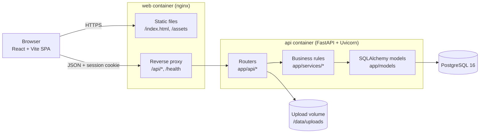
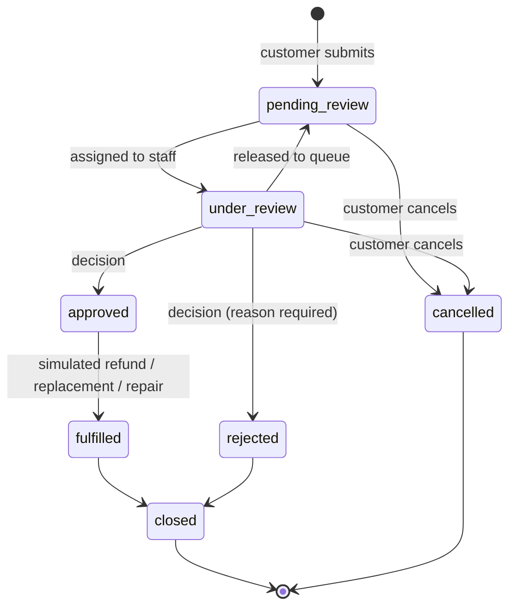
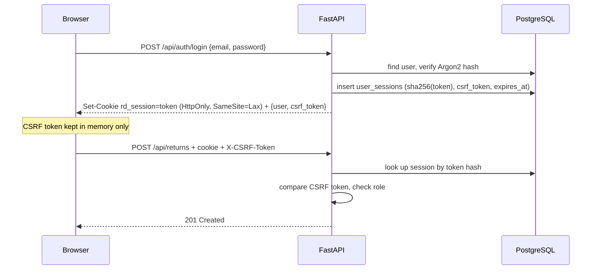

# Architecture

ReturnDesk is a single-repository monolith: one React single-page app, one FastAPI
service and one PostgreSQL database. There are no queues, caches or microservices —
the workload doesn't need them, and keeping it small makes the code easy to follow.

## System overview

In development, Vite plays the role of nginx: it serves the React app on `:5173` and
proxies `/api` to Uvicorn on `:8000`. Either way the browser sees **one origin**, so the
session cookie can stay `SameSite=Lax` and no cross-origin cookie configuration is needed.

## Backend layout

| Folder | What lives there |
|---|---|
| `app/core` | Settings (`pydantic-settings`), database engine/session, password hashing, auth dependencies |
| `app/models` | SQLAlchemy 2.0 models and the string enums used for statuses, reasons, roles |
| `app/schemas` | Pydantic request/response models and input validation |
| `app/api` | FastAPI routers: `auth`, `catalog` (products, purchases), `returns`, `admin` (users, settings, analytics, notifications) |
| `app/services` | Business logic with no HTTP details: return workflow, analytics queries, uploads, notifications |
| `app/seed.py` | Deterministic demo data |
| `alembic/` | Migrations |

Routers stay thin: they parse input, call a service function, commit, and shape the
response. All rules (who may do what, which transitions are legal, how much can be
returned) live in `app/services/returns.py`, which keeps them in one place and easy to test.

## Request lifecycle

* The allowed transitions are a dictionary in `ALLOWED_TRANSITIONS`; anything else returns **409 Conflict**.
* Every status change writes a `return_events` row in the same transaction as the status update.
* Decision, fulfillment, close and cancel lock the request row with `SELECT … FOR UPDATE`,
  so two people acting at once can't both succeed (covered by a concurrency test).
* "Approved" is not "refunded": fulfillment is a separate step and is only simulated.

## Authentication and authorization

* **Sessions** are server-side rows, so logout and deactivation take effect immediately.
  Only a SHA-256 hash of the cookie value is stored.
* **CSRF**: every non-GET request must send the per-session `X-CSRF-Token` header
  (synchronizer token pattern). The frontend gets it from the login response or `/api/auth/me`.
* **Roles** are checked in FastAPI dependencies (`require_customer`, `require_staff`,
  `require_admin`). Ownership checks (customer A vs. customer B) happen in the service layer
  and return **404** so request ids can't be probed. The React route guards are only for UX.

## Frontend layout

| Folder | What lives there |
|---|---|
| `src/api` | Axios instance (cookies, CSRF header, error messages) and one object per API area |
| `src/context` | `AuthProvider` (session restore, login/logout) and `ToastProvider` |
| `src/hooks` | `useAsync` for loading/error/data state, `useDebouncedValue` for search boxes |
| `src/components` | `ui/` building blocks, `layout/` shell, `requests/` shared request views, `charts/` Recharts components |
| `src/pages` | One folder per portal: `auth`, `customer`, `staff`, `admin`, `shared` |
| `src/utils` | Labels and colors, formatting, client-side validation, date ranges |

Pages are lazy-loaded per route, which keeps Recharts out of the first bundle for customers.
