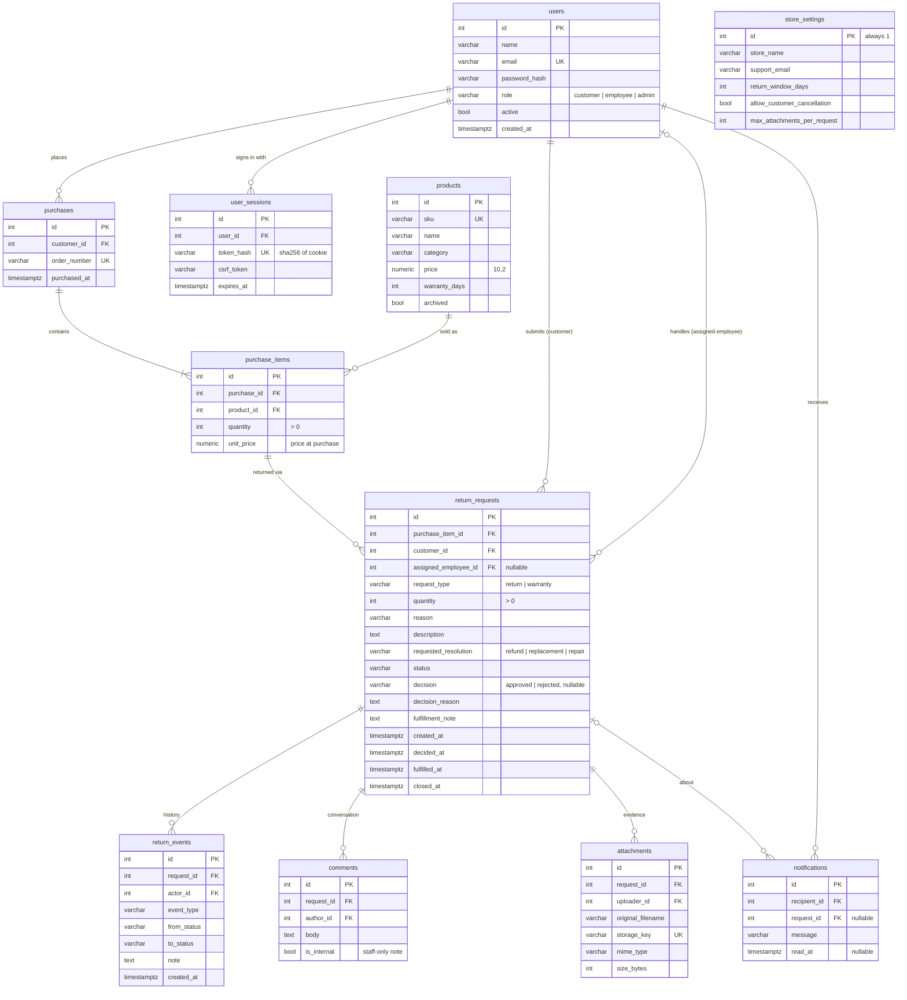

# Database

PostgreSQL 16 (CI and Docker) / 14+ (local). Schema is managed by Alembic:
`backend/alembic/versions/20261102_0001_initial_schema.py`.

## Entity relationship diagram

## Notes on the design

* **Money** is `NUMERIC(10,2)`, never float. `purchase_items.unit_price` keeps the price paid,
  so editing a product's price later doesn't change past orders.
* **Timestamps** are all `timestamptz` and written in UTC.
* **Enums** are stored as `VARCHAR` with `CHECK` constraints (SQLAlchemy `native_enum=False`).
  Adding a value later is a simple migration instead of an `ALTER TYPE`.
* **Indexes**: unique on `users.email`, `products.sku`, `purchases.order_number`; plain indexes on
  every foreign key plus `return_requests.status` and `return_requests.created_at` (queue filters
  and analytics both use them).
* **Extra columns beyond the blueprint**: `decision`, `decided_at`, `fulfilled_at`, `closed_at` make
  the analytics exact (approval trends by decision month, resolution time from `closed_at`) without
  re-reading the event log. `comments.is_internal` supports staff-only notes. `store_settings` holds
  the configurable return policy. `user_sessions` backs server-side sessions.
* **Returnable quantity** isn't stored; it's computed as
  `purchased quantity − Σ quantity of requests of the same type that aren't rejected or cancelled`.
  Return and warranty requests are counted separately.

## Seed data

`python -m app.seed --reset` creates deterministic fictional data: 1 admin, 5 employees
(one deactivated), 12 customers, 24 products in 6 categories, ~120 purchases and ~120 requests
spread over the last 12 months in every status. Dates are relative to the day you run it, so the
demo always has recent activity. All emails use the reserved `example.com` domain.
